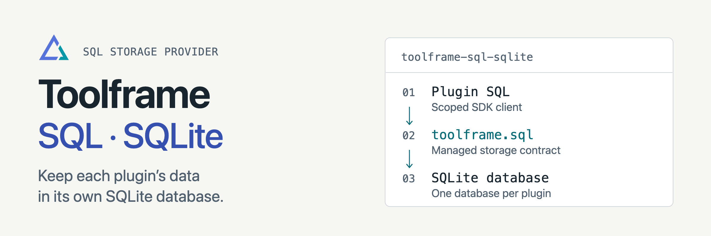

<p align="center">
<picture>
  <source media="(prefers-color-scheme: dark)" srcset="docs/assets/readme-banner-dark.png">
  <source media="(prefers-color-scheme: light)" srcset="docs/assets/readme-banner-light.png">
  
</picture>
</p>

# Toolframe SQLite

[](https://github.com/toolframe/toolframe-sql-sqlite/actions/workflows/ci.yml?query=branch%3Amain)

Give each Toolframe plugin a managed SQLite database.
Plugins use scoped SQL clients while the provider owns connections, transactions and migrations.

## Quick start

In a running [Toolframe application](https://github.com/toolframe/toolframe-core#readme):

```sh
toolframe --home APP plugin add pypi:toolframe-sql-sqlite==0.4.2 --enable
```

Enable this provider before plugins that require `toolframe.sql`. Use Python
3.14+ and SDK 0.4+. Business code calls `RuntimeContext.sql()`; database paths and
raw connections remain private to the provider.

**Storage:** databases live at `data/plugins/<plugin-id>/data.sqlite` and survive
disable or uninstall. Existing schema changes require an explicit migration plan
and backup. Transactions cover one store; cross-plugin access goes through the
owning business service. Plugins are trusted code.

## Guides

| I want to… | Start here |
| --- | --- |
| Use transactions and migrations | [Storage behavior](docs/storage.md) |
| Write portable SQL | [SDK storage](https://github.com/toolframe/toolframe-sdk/blob/main/docs/storage.md) |
| Operate application storage | [Core SQL guide](https://github.com/toolframe/toolframe-core/blob/main/docs/sql-storage.md) |
| Contribute or run checks | [Contributing](CONTRIBUTING.md) · [Verification](docs/ci.md) |
| Publish a package | [Releasing](docs/releasing.md) |

[Releases](https://github.com/toolframe/toolframe-sql-sqlite/releases)

## License

[Apache 2.0](LICENSE), with [NOTICE](NOTICE).
